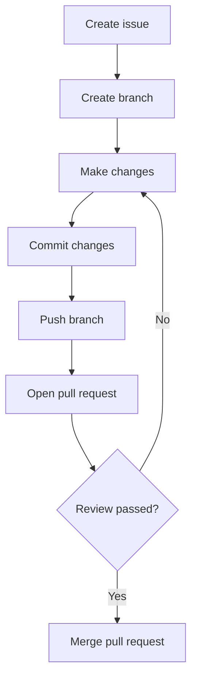
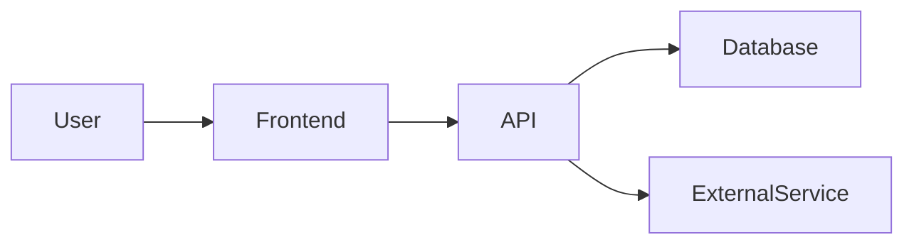

# Module 1 — Code

## Lesson 25: GitHub Documentation — Repository Docs, Wiki, GitHub Pages, and Documentation Automation

**Level:** Advanced
**Type:** Practical project
**Suggested filename:** `lesson-25-documentation-management.md`
**Suggested branch:** `docs/lesson-25-documentation-management`

---

## 1. Lesson overview

Professional documentation helps developers understand a project, install and use it, contribute safely, and maintain it as the project evolves.

In this lesson, you’ll build a documentation system using:

- Repository documentation files such as `README.md`, `CONTRIBUTING.md`, and `SECURITY.md`
- GitHub Wiki as a collaborative knowledge base
- GitHub Pages as a published documentation website
- Versioned documentation, Markdown features, and Mermaid diagrams
- GitHub Actions to automate documentation checks

The central skill is deciding **which documentation belongs where** and keeping each location accurate as the repository changes.

## 2. Learning objectives

By the end of this lesson, you should be able to:

1. Design a clear repository documentation structure.
2. Explain the purpose of standard repository documentation files.
3. Create and maintain GitHub Wiki pages.
4. Publish a simple documentation website with GitHub Pages.
5. Organize documentation for multiple application versions.
6. Use advanced Markdown features and Mermaid diagrams.
7. Add automated Markdown checks with GitHub Actions.
8. Include documentation updates in code review and release workflows.

## 3. Understand the documentation locations

GitHub offers several complementary documentation locations.

| Location | Best use | Examples |
|---|---|---|
| Repository files | Core project documentation committed with the code | `README.md`, `CONTRIBUTING.md`, `docs/` |
| GitHub Wiki | Independently edited, Git-backed knowledge base | Troubleshooting, FAQs, operational procedures |
| GitHub Pages | Public, browsable static website | User manuals, developer guides, training material |

Use the repository’s `README.md` to explain what the project is and how to get started. Use `docs/` for detailed technical material. Use a Wiki for knowledge that benefits from independent editing and navigation. Use Pages when readers need a published website.

These systems can work together. Avoid maintaining the same instructions in several places unless there is a clear reason.

### Exercise 1 — Audit your repository

From your local repository, inspect the current branch and file structure.

```powershell
git status
git branch --show-current
tree /F
```

If `tree /F` is unavailable, use:

```powershell
Get-ChildItem -Recurse -File | Select-Object FullName
```

Record which documentation files already exist and which are missing.

## 4. Build a repository documentation structure

A useful documentation structure should help a new contributor find the project overview, contribution instructions, technical guides, and support information.

A possible structure for the training repository is:

```text
github-training/
├── .github/
│   ├── ISSUE_TEMPLATE/
│   ├── PULL_REQUEST_TEMPLATE.md
│   └── workflows/
│       └── docs-check.yml
├── github-training-modules/
│   └── module-01-code/
│       ├── lesson-01-...
│       └── lesson-25-documentation-management.md
├── docs/
│   ├── architecture/
│   ├── guides/
│   ├── images/
│   ├── troubleshooting/
│   └── versions/
├── README.md
├── CONTRIBUTING.md
├── CODE_OF_CONDUCT.md
├── SECURITY.md
├── SUPPORT.md
├── CHANGELOG.md
└── LICENSE
```

This is a suggested structure, not a mandatory GitHub convention. Keep the structure proportional to the size and needs of the repository.

### Exercise 2 — Plan your documentation layout

Create a short inventory of the documentation your repository needs. For each file or folder, write one sentence describing its purpose.

## 5. README.md — the repository entry point

The `README.md` is usually the first document visitors see. It should answer:

- What is this project?
- Why does it exist?
- What does it contain?
- How do I install or use it?
- How can I contribute?
- Where can I find more information?

A practical README structure is:

```markdown
# Project Name

A short description of the project.

## Overview

Explain the project's purpose.

## Features

- Feature one
- Feature two

## Technology Stack

- Technology A
- Technology B

## Project Structure

Explain the important directories.

## Requirements

List the required software and versions.

## Installation

Provide setup instructions.

## Usage

Show how to use the project.

## Testing

Explain how to run tests.

## Documentation

Link to detailed documentation.

## Contributing

Explain how to contribute.

## License

State the project's license.
```

Keep the README concise. Move extensive tutorials, architecture details, and operational procedures into appropriate documentation files.

### Exercise 3 — Improve your README

Review your current `README.md`. Add or improve:

- Project overview and learning objectives
- Repository structure
- Module list and instructions for following the lessons
- Contribution instructions
- License information

## 6. CONTRIBUTING.md — define the contribution workflow

`CONTRIBUTING.md` explains how developers should work with the repository. It should cover:

1. Reporting bugs and proposing features
2. Forking and cloning the repository
3. Creating branches
4. Writing commits
5. Opening pull requests
6. Required checks and review expectations
7. Updating documentation when needed

### Example contribution workflow

```bash
# Fork the repository on GitHub first.

# Clone your fork
git clone https://github.com/YOUR_USERNAME/github-training.git
cd github-training

# Create a branch
git switch -c docs/improve-contributing-guide

# Make changes, then stage them
git add CONTRIBUTING.md

# Commit
git commit -m "docs: improve contribution guidelines"

# Push
git push -u origin docs/improve-contributing-guide
```

Then open a pull request on GitHub.

### Branch and commit conventions

| Change type | Branch example | Commit example |
|---|---|---|
| Feature | `feature/add-search` | `feat: add search` |
| Bug fix | `fix/login-validation` | `fix: correct login validation` |
| Documentation | `docs/update-readme` | `docs: update installation guide` |
| Refactoring | `refactor/auth-service` | `refactor: simplify user service` |
| Tests | `test/user-permissions` | `test: add permission tests` |
| CI | `ci/docs-checks` | `ci: add documentation checks` |

### Exercise 4 — Write contribution guidelines

Update `CONTRIBUTING.md` with your branch naming rules, commit conventions, pull request expectations, testing requirements, and documentation update expectations.

## 7. CODE_OF_CONDUCT.md — establish community expectations

A Code of Conduct describes expected behavior for people participating in a project. Common sections include:

- Community standards
- Unacceptable behavior
- Maintainer responsibilities
- How to report concerns
- Enforcement guidelines

You can adopt a recognized standard, such as the [Contributor Covenant](https://www.contributor-covenant.org/), rather than inventing an incomplete policy.

### Exercise 5 — Add a Code of Conduct

Create `CODE_OF_CONDUCT.md`. Explain expected professional behavior, examples of unacceptable conduct, how to report concerns, and how maintainers handle reports. Do not publish private contact details.

## 8. SECURITY.md — explain vulnerability reporting

Security reporting should not depend on a public GitHub Issue. A public issue can expose a vulnerability before maintainers have investigated or prepared a fix.

A security policy should explain:

- Which versions are supported
- How to report a vulnerability privately
- Whether GitHub private vulnerability reporting is enabled
- What response reporters can expect
- Responsible disclosure expectations

Example structure:

```markdown
# Security Policy

## Supported Versions

| Version | Supported |
|---|---|
| 1.x | Yes |
| 0.x | No |

## Reporting a Vulnerability

Please do not report security vulnerabilities through public issues.

Use the repository's private vulnerability reporting process
or the designated security contact.

## Response Expectations

Maintainers will acknowledge reports and assess their severity.

## Disclosure

Please allow maintainers time to investigate and prepare a fix
before publicly disclosing a vulnerability.
```

The version table is illustrative. Adjust it to match the versions your project actually supports.

GitHub provides private vulnerability reporting for eligible repositories. See [GitHub’s vulnerability reporting guidance](https://docs.github.com/en/code-security/security-advisories/guidance-on-reporting-and-writing-a-vulnerability).

### Exercise 6 — Create a security policy

Create `SECURITY.md` and document supported versions, the reporting process, maintainer response expectations, and disclosure expectations.

## 9. SUPPORT.md — route questions to the right place

`SUPPORT.md` helps users find the correct channel for each kind of request.

| Request | Where to go |
|---|---|
| Bug report | GitHub Issues |
| Feature request | GitHub Issues or Discussions |
| Usage question | Discussions |
| Security vulnerability | Private security reporting |
| Contribution question | `CONTRIBUTING.md` |

Avoid directing ordinary usage questions to the bug-reporting process.

### Exercise 7 — Create support instructions

Create `SUPPORT.md` with clear instructions for each type of request.

## 10. GitHub Wiki — a separate knowledge base

A GitHub Wiki is a collection of pages attached to a repository. It is useful for material that benefits from independent editing and browsing.

Good Wiki content includes:

- Architecture explanations
- Troubleshooting procedures
- FAQs
- Development environment setup
- Operational runbooks
- Team onboarding guides
- Meeting notes and decision records

Avoid duplicating the same content in the Wiki and `docs/` without a clear reason. Duplicated instructions can become inconsistent.

### 10.1 Create your first Wiki page

1. Open the repository on GitHub.
2. Select the **Wiki** tab.
3. If the Wiki is not initialized, create its first page.
4. Name the page `Home`.
5. Add Markdown content and save it.

A possible Wiki structure is:

```text
Home
├── Getting-Started
├── Development-Environment
├── Architecture
│   ├── Repository-Architecture
│   ├── Git-Workflow
│   └── Documentation-Strategy
├── Troubleshooting
│   ├── Git-Problems
│   ├── Authentication-Problems
│   └── GitHub-Actions-Problems
└── FAQ
```

### 10.2 Example Wiki page

A page named `Development-Environment` could contain:

```markdown
# Development Environment

## Requirements

- Git
- GitHub account
- Code editor

## Setup

1. Clone the repository.
2. Open the project.
3. Follow the instructions in README.md.

## Related Pages

- [Getting Started](Getting-Started)
- [Architecture](Architecture)
- [Troubleshooting](Troubleshooting)
```

Wiki links use page names rather than ordinary repository-relative file paths.

### 10.3 Edit the Wiki locally

A Wiki is a separate Git repository. Its history and branches are not the same as the main project’s history.

```bash
git clone https://github.com/OWNER/REPOSITORY.wiki.git
cd REPOSITORY.wiki

# Create or edit a Markdown page.

git add .
git commit -m "docs: add troubleshooting wiki page"
git push
```

For this training repository:

```bash
git clone https://github.com/yassine-B/github-training.wiki.git
```

### Exercise 8 — Create your Wiki

Create these pages:

1. `Home`
2. `Getting-Started`
3. `Git-Workflow`
4. `Troubleshooting`
5. `FAQ`

Add links between the pages and make `Home` the navigation starting point.

## 11. GitHub Pages — publish a documentation website

GitHub Pages publishes a static website from a repository. It is useful when documentation needs a structured reading experience beyond a collection of Markdown files.

Common use cases include developer documentation, user manuals, product documentation, API guides, portfolios, and training material.

### 11.1 Publishing approaches

| Approach | Description |
|---|---|
| Deploy from a branch | Publish from the root or `/docs` folder of a selected branch |
| GitHub Actions | Build and deploy through a custom workflow |

For a simple static page, publishing from a branch may be enough. A custom Actions workflow gives more control when using a static-site generator.

### 11.2 Publish a simple page

Create:

```text
docs/
└── index.html
```

Example `docs/index.html`:

```html
<!DOCTYPE html>
<html lang="en">
<head>
    <meta charset="UTF-8">
    <meta name="viewport" content="width=device-width, initial-scale=1.0">
    <title>GitHub Training</title>
</head>
<body>
    <h1>GitHub Training</h1>

    <p>
        A practical learning repository for GitHub
        and professional development workflows.
    </p>

    <h2>Modules</h2>

    <ul>
        <li>Module 1 — Code</li>
        <li>Module 2 — Issues</li>
        <li>Module 3 — Pull Requests</li>
        <li>Module 4 — Agents</li>
        <li>Module 5 — Actions</li>
    </ul>
</body>
</html>
```

### 11.3 Configure GitHub Pages

1. Open the repository on GitHub.
2. Go to **Settings**.
3. Open **Pages**.
4. Under **Build and deployment**, choose **Deploy from a branch**.
5. Select the default branch.
6. Select `/docs` as the folder.
7. Save.

GitHub Pages settings will show the published URL when it becomes available. See the [GitHub Pages publishing guide](https://docs.github.com/en/pages/getting-started-with-github-pages/configuring-a-publishing-source-for-your-github-pages-site).

> [!WARNING]
> GitHub Pages websites are publicly accessible. Do not publish private notes, credentials, API keys, personal information, or internal-only documentation. A private source repository does not make the published website private.

### Exercise 9 — Publish your training site

Publish the page and verify:

- The Pages deployment completes.
- The website opens.
- The page displays the module list.
- A later change to `index.html` appears on the website.

## 12. Documentation versioning

Documentation changes as software changes. A guide written for version `v1.0.0` may not accurately describe version `v2.0.0`.

For real applications, identify which software version each guide describes.

Example structure:

```text
docs/
├── v1/
│   ├── installation.md
│   ├── configuration.md
│   └── api.md
├── v2/
│   ├── installation.md
│   ├── configuration.md
│   └── api.md
└── current/
    ├── installation.md
    ├── configuration.md
    └── api.md
```

This is one possible approach. Larger projects may use documentation tools that manage versioned documentation automatically.

### Documentation and releases

| Software release | Documentation |
|---|---|
| `v1.0.0` | Documentation for version 1 |
| `v1.1.0` | Updated documentation for version 1.1 |
| `v2.0.0` | Documentation for version 2 |

When a breaking change is introduced, update the relevant migration and upgrade guides.

### Exercise 10 — Create a migration guide

Create:

```text
docs/
├── versions/
│   ├── v1.md
│   └── v2.md
└── migration/
    └── v1-to-v2.md
```

Write a hypothetical migration guide explaining how a developer should approach upgrading from version 1 to version 2. Clearly label it as a training example.

Before a release, check that installation instructions, environment variables, API endpoints, screenshots, migration guides, and changelog entries match the release.

## 13. Advanced Markdown and Mermaid diagrams

Markdown is the foundation of GitHub documentation. Learn to use more than headings and bullet points.

### 13.1 Useful Markdown features

#### Tables

```markdown
| Command | Purpose |
|---|---|
| `git status` | Check the working tree |
| `git log` | View commit history |
| `git branch` | List branches |
```

#### Task lists

```markdown
- [x] Create repository
- [x] Create documentation folder
- [ ] Configure GitHub Pages
- [ ] Add documentation checks
```

#### Collapsible sections

```html
<details>
<summary>Show additional information</summary>

This section contains additional information.

</details>
```

#### GitHub Markdown alerts

```markdown
> [!NOTE]
> Additional information.

> [!TIP]
> A useful recommendation.

> [!IMPORTANT]
> Important information.

> [!WARNING]
> Something needs attention.

> [!CAUTION]
> A potentially risky situation.
```

Use alerts sparingly. A warning should communicate a genuine warning, not decorate a paragraph.

### 13.2 Mermaid diagrams

Mermaid lets you create diagrams using text. GitHub can render supported Mermaid diagrams in Markdown.

Example: contribution workflow.

````markdown

````

Example: application architecture.

````markdown

````

### Exercise 11 — Add diagrams

Add at least two Mermaid diagrams to your training repository:

1. A GitHub contribution workflow
2. A documentation publishing workflow

Put each diagram in a relevant lesson or guide rather than placing every diagram in the README.

## 14. Documentation automation with GitHub Actions

Documentation should be reviewed like code. Broken links, inconsistent formatting, and invalid documentation structure can make a repository difficult to maintain.

GitHub Actions can check documentation whenever a pull request is opened or updated.

### 14.1 What can be checked?

| Check | Purpose |
|---|---|
| Markdown lint | Find Markdown formatting problems |
| Link checking | Detect broken links |
| Spell checking | Identify spelling errors |
| Required files | Ensure essential documentation exists |
| Build check | Verify that the documentation website builds |
| Deployment | Publish updated documentation |

### 14.2 Add Markdown lint configuration

Create `.markdownlint.json`:

```json
{
  "default": true,
  "MD013": false,
  "MD033": false,
  "MD041": false
}
```

This disables:

- `MD013`: line-length rule
- `MD033`: inline HTML rule
- `MD041`: first-line heading rule

These are policy choices, not universal best practices. Adjust them to suit your documentation style.

### 14.3 Add a documentation validation workflow

Create `.github/workflows/docs-check.yml`:

```yaml
name: Documentation Checks

on:
  pull_request:
    paths:
      - "**/*.md"
      - ".markdownlint.json"
      - ".github/workflows/docs-check.yml"
  push:
    branches:
      - main
    paths:
      - "**/*.md"
      - ".markdownlint.json"
      - ".github/workflows/docs-check.yml"

permissions:
  contents: read

jobs:
  markdown-lint:
    name: Markdown Lint
    runs-on: ubuntu-latest

    steps:
      - name: Checkout repository
        uses: actions/checkout@v4

      - name: Set up Node.js
        uses: actions/setup-node@v4
        with:
          node-version: 22

      - name: Install markdownlint-cli
        run: npm install --global markdownlint-cli

      - name: Check Markdown files
        run: markdownlint "**/*.md" --ignore node_modules
```

This starter workflow checks Markdown formatting. It does not validate every link, spelling issue, or website build.

**Why the main parts matter:**

- `on` defines when the workflow runs.
- `pull_request` checks documentation changes before merging.
- `push` checks changes after they reach `main`.
- `paths` avoids running this workflow for unrelated changes.
- `permissions` gives the workflow read-only repository access.
- `runs-on` selects the runner environment.
- `actions/checkout` checks out the repository.
- `actions/setup-node` provides Node.js.
- `markdownlint-cli` checks Markdown formatting.

GitHub Actions workflows use YAML. Assign the `GITHUB_TOKEN` only the permissions the workflow requires. See the [GitHub Actions documentation](https://docs.github.com/en/actions).

### 14.4 Test the workflow

Create a branch:

```bash
git switch -c ci/add-documentation-checks
```

Add the workflow and configuration, then commit:

```bash
git add .github/workflows/docs-check.yml .markdownlint.json
git commit -m "ci: add markdown documentation checks"
git push -u origin ci/add-documentation-checks
```

Open a pull request. Inspect the PR’s **Checks** section and the workflow run in the **Actions** tab. Review the individual steps and any lint errors.

### Exercise 12 — Break and fix the workflow

1. Add a Markdown file with deliberately inconsistent formatting.
2. Push it to your branch.
3. Open or update the pull request.
4. Inspect the failed workflow.
5. Fix the Markdown.
6. Push again.
7. Confirm the check passes.

This controlled experiment shows how CI catches documentation problems before they reach the default branch.

## 15. Maintain documentation as part of development

Consider a software project with a Django REST Framework backend, React frontend, PostgreSQL database, Docker Compose development environment, and GitHub Actions CI/CD.

A reasonable documentation layout could be:

```text
project/
├── backend/
├── frontend/
├── infrastructure/
├── docs/
│   ├── architecture/
│   │   ├── system-overview.md
│   │   ├── authentication.md
│   │   └── database-design.md
│   ├── development/
│   │   ├── local-setup.md
│   │   ├── environment-variables.md
│   │   └── testing.md
│   ├── deployment/
│   │   ├── docker.md
│   │   ├── production.md
│   │   └── backups.md
│   ├── api/
│   │   └── api-conventions.md
│   └── troubleshooting/
│       └── common-errors.md
├── .github/
│   └── workflows/
├── README.md
├── CONTRIBUTING.md
├── SECURITY.md
├── SUPPORT.md
└── CHANGELOG.md
```

### Documentation ownership

| Documentation | Typical owner |
|---|---|
| Project overview | Project maintainers |
| Local development | Backend and frontend developers |
| API documentation | Backend developers |
| UI usage guides | Frontend or product team |
| Deployment procedures | DevOps team |
| Security policy | Maintainers or security owner |
| Changelog | Contributors and release manager |

### Include documentation in code review

A pull request that changes application behavior may also require a documentation update.

| Code change | Documentation to review |
|---|---|
| New environment variable | Configuration guide |
| New API endpoint | API documentation |
| Authentication behavior changes | Authentication guide |
| New deployment process | Deployment guide |
| Breaking change | Migration guide and changelog |

Add a documentation checklist to your pull request template:

```markdown
## Documentation checklist

- [ ] README updated if necessary
- [ ] Technical documentation updated
- [ ] API documentation updated if necessary
- [ ] Environment variables documented
- [ ] Changelog updated if necessary
- [ ] Mermaid diagrams updated if necessary
- [ ] Documentation links checked
```

### Exercise 13 — Add a documentation review checklist

Add the checklist to your PR template. Then create a sample pull request that changes a lesson and updates the relevant documentation index.

## 16. Documentation quality checklist

Use this checklist before considering the repository’s documentation complete.

- [ ] README explains the project’s purpose and how to get started
- [ ] CONTRIBUTING explains the contribution workflow
- [ ] CODE_OF_CONDUCT establishes community expectations
- [ ] SECURITY explains vulnerability reporting
- [ ] SUPPORT identifies the right help channels
- [ ] Documentation is organized into logical folders
- [ ] Wiki pages have useful navigation and links
- [ ] GitHub Pages publishes the intended public content
- [ ] Documentation versions match supported software versions
- [ ] Markdown diagrams render correctly
- [ ] Automated Markdown checks pass
- [ ] Pull requests include documentation review where relevant
- [ ] Release notes and migration guides are updated

## 17. Practical assignment

Turn your `github-training` repository into a documentation system.

### Required deliverables

| # | Deliverable | Location |
|---|---|---|
| 1 | Improved project overview | `README.md` |
| 2 | Contribution guidelines | `CONTRIBUTING.md` |
| 3 | Community guidelines | `CODE_OF_CONDUCT.md` |
| 4 | Security policy | `SECURITY.md` |
| 5 | Support instructions | `SUPPORT.md` |
| 6 | Organized technical documentation | `docs/` |
| 7 | Wiki knowledge base | GitHub Wiki |
| 8 | Published documentation page | GitHub Pages |
| 9 | Documentation version examples | `docs/versions/` |
| 10 | Mermaid diagrams | Relevant Markdown files |
| 11 | Markdown lint configuration | `.markdownlint.json` |
| 12 | Automated documentation checks | `.github/workflows/docs-check.yml` |

### Recommended execution order

1. Create your documentation branch.
2. Improve the README.
3. Create the four community health files.
4. Organize the `docs/` directory.
5. Create your Wiki pages.
6. Publish the simple GitHub Pages site.
7. Add Mermaid diagrams.
8. Add Markdown lint configuration and workflow.
9. Test the workflow using a pull request.
10. Review everything and merge.

## 18. Git workflow — commit, PR, tag, and release

Start from the latest default branch:

```bash
git switch main
git pull origin main
git switch -c docs/lesson-25-documentation-management
```

Save this lesson as:

```text
github-training-modules/module-01-code/lesson-25-documentation-management.md
```

Commit and push:

```bash
git add .
git commit -m "docs(github): add Lesson 25 documentation management"
git push -u origin docs/lesson-25-documentation-management
```

### Pull request

#### Title

```text
docs(github): add Lesson 25 — Documentation Management
```

#### Description

```markdown
## Summary

- Add Lesson 25 documentation management.
- Cover repository documentation files.
- Explain GitHub Wiki and GitHub Pages.
- Introduce Mermaid and advanced Markdown.
- Add automated documentation validation.

## Checklist

- [ ] Lesson content reviewed
- [ ] Markdown formatting checked
- [ ] Examples verified
- [ ] Documentation links checked
```

After the PR is reviewed and merged, create the training checkpoint tag:

```bash
git switch main
git pull origin main

git tag -a module-01-lesson-25 -m "Complete Module 1 Lesson 25"
git push origin module-01-lesson-25
```

If the tag already exists, do not recreate it. This is a training checkpoint, not a software SemVer release.

### GitHub Release

- **Tag:** `module-01-lesson-25`
- **Release title:** `Module 1 — Lesson 25: Documentation Management`
- **Description:** `Completed repository documentation, GitHub Wiki, GitHub Pages, Mermaid diagrams, documentation versioning, and documentation automation.`

## 19. Official documentation and references

1. [About README files](https://docs.github.com/en/repositories/managing-your-repositorys-settings-and-features/customizing-your-repository/about-readmes)
2. [Setting guidelines for repository contributors](https://docs.github.com/en/communities/setting-up-your-project-for-healthy-contributions/setting-guidelines-for-repository-contributors)
3. [GitHub community documentation](https://docs.github.com/en/communities)
4. [GitHub Pages documentation](https://docs.github.com/en/pages)
5. [About GitHub Wikis](https://docs.github.com/en/communities/documenting-your-project-with-wikis/about-wikis)
6. [GitHub Actions documentation](https://docs.github.com/en/actions)
7. [Mermaid documentation](https://mermaid.js.org/intro/)

## 20. What comes next?

Lesson 25 is complete when your documentation assignment is merged and tagged.

### Lesson 26 — GitHub Issues: Issue Management, Templates, Labels, Milestones, and Project Workflows

In Lesson 26, you’ll work with issue creation and management, issue forms, labels, milestones, assignees, pull request linking, automatic issue closing, issue relationships, and practical bug-tracking and feature-planning workflows.
