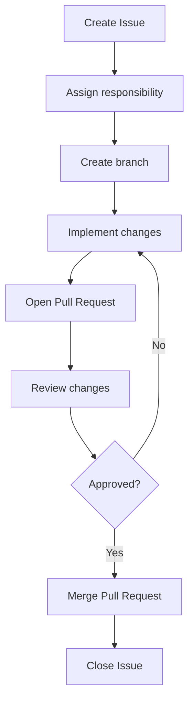
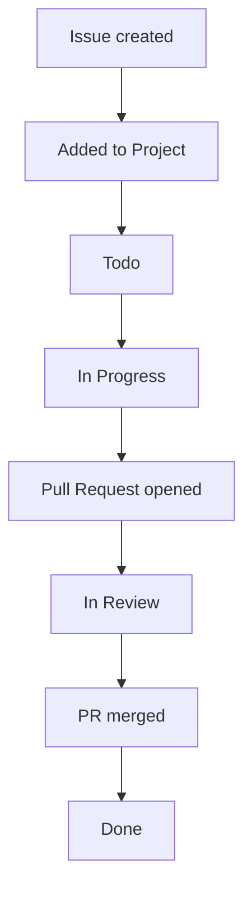

# Module 2 — Issues

## Lesson 26: GitHub Issues — Issue Management, Templates, Labels, Milestones, and Project Workflows

**Level:** Advanced
**Format:** Hands-on training
**Repository:** `github-deep-dive-training`
**Module:** 2 — Issues

---

## Lesson overview

In this lesson, we'll move from the **Code** tab to the **Issues** tab of your `github-deep-dive-training` repository.

GitHub Issues provides a structured way to manage software development work. Teams use Issues to report bugs, request features, plan improvements, assign responsibilities, and track progress.

The objective is to build a complete issue-management workflow rather than simply learning how to create an Issue.

We'll work with a realistic restaurant SaaS project as our recurring example.

By the end, you'll have created Issues, configured labels and milestones, implemented templates and YAML forms, connected Issues to Pull Requests, explored dependencies and sub-issues, and integrated everything with GitHub Projects and GitHub Actions.

## 1. Learning objectives

By the end of this lesson, you should understand how to:

1. Create, edit, assign, and close GitHub Issues.
2. Distinguish Issues from Pull Requests.
3. Understand issue types and labels.
4. Create and manage milestones.
5. Assign Issues to collaborators.
6. Create Markdown issue templates.
7. Build structured Issue Forms using YAML.
8. Search and filter Issues using advanced queries.
9. Link Issues to Pull Requests and commits.
10. Automatically close Issues after merging Pull Requests.
11. Organize large tasks using sub-issues.
12. Manage dependencies and blocking relationships.
13. Perform common Issue administration operations.
14. Automate Issue management using GitHub Actions.
15. Connect Issues to GitHub Projects.
16. Build a professional issue-management workflow.

## 2. Understanding GitHub Issues

An Issue is a trackable unit of work within a repository.

It can represent:

- A bug.
- A new feature.
- A technical improvement.
- A documentation task.
- A security-related task.
- A maintenance task.
- A question or discussion.

### 2.1 Real-world example

Imagine you're developing a restaurant management system.

Your team discovers that customers can submit duplicate orders when they click the checkout button repeatedly.

Create an Issue:

#### #42 — Prevent duplicate order submissions

Example description:

```markdown
## Problem

Customers can sometimes submit the same order more than once
when they click the checkout button repeatedly.

## Expected behavior

Each checkout request should be processed only once.

## Acceptance criteria

- [ ] Duplicate submissions are prevented.
- [ ] The customer receives appropriate feedback.
- [ ] Automated tests cover repeated submissions.
```

Possible labels:

- `type: bug`
- `priority: high`
- `area: backend`

The Issue becomes the central place for discussing the problem, assigning responsibility, documenting the solution, and tracking completion.

### 2.2 Issue versus Pull Request

| Issue | Pull Request |
|---|---|
| Describes work to be done | Proposes code changes |
| Tracks bugs and features | Reviews and merges changes |
| Contains discussions | Contains code diffs and reviews |
| Can be assigned | Can request reviewers |
| Can be linked to PRs | Can automatically close Issues |

### 2.3 Typical development lifecycle



**Important:** An Issue describes the work. A Pull Request proposes the implementation.

## 3. Explore the Issues tab

Open your training repository:

[github-deep-dive-training — Issues](https://github.com/yassine-B/github-deep-dive-training/issues)

Depending on your repository configuration and GitHub interface version, you'll encounter:

| Element | Purpose |
|---|---|
| New issue | Create an Issue |
| Open | View unresolved Issues |
| Closed | View completed or closed Issues |
| Labels | Categorize Issues |
| Milestones | Group work around goals |
| Assignees | Identify responsible people |
| Search | Find Issues using filters |
| Issue types | Classify work using configured types |

Some features depend on repository settings, account permissions, and GitHub plan availability.

### Exercise 1 — Explore the interface

Open the Issues tab and identify:

1. Where you create an Issue.
2. Where you find closed Issues.
3. How to filter by label.
4. How to filter by assignee.
5. How to find milestone-related Issues.

Don't create anything yet. First become familiar with the interface.

## 4. Creating and managing your first Issues

Open the Issues tab and select **New issue**.

If templates are already configured, GitHub may ask you to select one. For this first exercise, create an Issue manually.

### 4.1 Create a documentation Issue

#### Title

```text
docs: create a complete GitHub Issues learning guide
```

#### Description

```markdown
## Objective

Create comprehensive documentation covering GitHub Issues.

## Scope

- Issue creation and management
- Labels
- Milestones
- Assignees
- Issue templates
- Issue forms
- Issue search and filtering
- Pull Request integration

## Acceptance criteria

- [ ] Issue management is documented.
- [ ] Labels are explained.
- [ ] Milestones are explained.
- [ ] Templates are configured.
- [ ] Practical exercises are included.

## Related module

Module 2 — Issues
```

Create the Issue.

### 4.2 Understand Issue fields

| Field | Explanation |
|---|---|
| Title | Short description of the task |
| Description | Detailed explanation |
| Assignees | People responsible |
| Labels | Work classification |
| Milestone | Release or target grouping |
| Projects | Project-management board |
| Type | Classification, if configured |

### 4.3 Create three practice Issues

Create the following Issues in your training repository.

#### Issue A — Bug report

```text
bug: documentation links are broken
```

#### Issue B — Feature request

```text
feat: add advanced GitHub Actions training
```

#### Issue C — Documentation

```text
docs: create GitHub Wiki training guide
```

Use appropriate descriptions and acceptance criteria.

Keep all three open for the next exercises.

### Exercise 2 — Issue creation

Verify that:

- Three Issues have been created.
- Each Issue has a meaningful description.
- Each Issue has acceptance criteria.
- All three Issues remain open.

## 5. Labels — categorize and organize Issues

Labels help you understand what an Issue represents without opening it.

Examples:

- `bug`
- `enhancement`
- `documentation`
- `high-priority`
- `backend`
- `frontend`
- `security`

GitHub repositories can have their own label systems.

### 5.1 Default GitHub labels

Common default labels include:

| Label | Purpose |
|---|---|
| `bug` | Something isn't working |
| `documentation` | Documentation improvements |
| `duplicate` | Duplicate Issue |
| `enhancement` | Feature request |
| `good first issue` | Suitable for new contributors |
| `help wanted` | Additional assistance needed |
| `invalid` | Issue is not valid |
| `question` | Additional information requested |
| `wontfix` | Work will not be implemented |

### 5.2 Create custom labels

Navigate to:

#### Repository → Issues → Labels → New label

Create these labels:

| Label | Description |
|---|---|
| `priority: critical` | Requires immediate attention |
| `priority: high` | High-priority work |
| `priority: medium` | Normal-priority work |
| `priority: low` | Low-priority work |
| `type: bug` | Bug report |
| `type: feature` | New functionality |
| `type: documentation` | Documentation task |
| `type: refactor` | Code refactoring |
| `area: backend` | Backend-related work |
| `area: frontend` | Frontend-related work |
| `area: devops` | Infrastructure and automation |
| `status: blocked` | Work is blocked |
| `status: needs-review` | Requires review |

Use consistent naming conventions. Avoid creating several labels that mean exactly the same thing.

### 5.3 Apply labels

Apply the following labels:

| Issue | Labels |
|---|---|
| Broken documentation links | `type: bug`, `priority: medium` |
| Advanced Actions training | `type: feature`, `area: devops` |
| Wiki training guide | `type: documentation` |

### 5.4 Label management

You can:

- Edit label names.
- Change colors.
- Update descriptions.
- Delete obsolete labels.
- Apply multiple labels.
- Filter Issues by labels.

**Important:** Deleting a label removes that classification from Issues that use it. Consider the impact before deleting labels used throughout the repository.

### Exercise 3 — Label administration

1. Create the custom labels above.
2. Apply labels to your three Issues.
3. Change one label's description.
4. Change one label's color.
5. Search for Issues using a particular label.
6. Identify all Issues with high priority.

## 6. Milestones — organize work around releases

A milestone is a collection of Issues and Pull Requests associated with a particular goal or deadline.

Think of a milestone as a development target.

Examples:

- Module 2 — Issues
- Module 3 — Pull Requests
- Module 4 — Agents
- Module 5 — Actions

### 6.1 Create a milestone

Navigate to:

#### Issues → Milestones → New milestone

Depending on your current GitHub interface, you may find Milestones under the Issues navigation or its related menus.

Create:

| Field | Value |
|---|---|
| Title | Module 2 — Issues |
| Description | Complete GitHub Issues training |
| Due date | Choose a realistic date |

Save the milestone.

### 6.2 Assign Issues to the milestone

Open each of your three Issues and assign:

```text
Module 2 — Issues
```

The milestone now tracks the progress of these tasks.

### 6.3 Understand milestone progress

GitHub tracks the number of open and closed Issues associated with a milestone.

Example:

```text
Module 2 — Issues

1 / 3 completed

1 closed
2 open
```

These numbers are illustrative, not your repository's live progress.

### 6.4 Milestones versus Projects

| Scenario | Milestone |
|---|---|
| Software release | `v1.0.0` |
| Development sprint | `Sprint 04` |
| Training module | `Module 2 — Issues` |
| Major feature | `Customer Notifications` |
| Infrastructure migration | `PostgreSQL Migration` |

Milestones group Issues around a target or deadline.

GitHub Projects provides more flexible planning, visualization, custom fields, and workflows.

### Exercise 4 — Milestone management

1. Create `Module 2 — Issues`.
2. Add your three Issues to it.
3. Create another milestone called `Module 3 — Pull Requests`.
4. Inspect the milestone progress.
5. Close one completed training Issue and observe the progress change.

## 7. Assignees — assign responsibility

An assignee is the person responsible for an Issue.

Examples:

- Backend developer → API bug.
- Frontend developer → UI improvement.
- DevOps engineer → deployment issue.
- Technical writer → documentation task.

### 7.1 Assign yourself

Open an Issue.

Find the **Assignees** section in its sidebar and select yourself.

You can also use the `assign yourself` action where available.

### 7.2 Assign multiple people

Depending on repository permissions and GitHub's current limits, an Issue can have multiple assignees.

Example:

| Issue | Assignee |
|---|---|
| Broken documentation links | You |
| Advanced Actions training | You |
| Wiki training guide | You |

### 7.3 Assignees versus reviewers

| Assignee | Reviewer |
|---|---|
| Responsible for completing the Issue | Responsible for reviewing a PR |
| Used on Issues | Used on Pull Requests |
| Tracks work ownership | Tracks code-review responsibility |

An assignee is not automatically a reviewer.

### Exercise 5 — Assignment

Assign yourself to your three Issues.

Then:

1. Open your assigned Issues filter.
2. Find all Issues assigned to you.
3. Remove yourself from one Issue.
4. Inspect how the Issue assignment changes.

## 8. Issue types — classify work

GitHub supports structured issue classification through issue types in supported repository and organization configurations.

The exact available types depend on the features enabled for your account and repository.

Typical categories include:

| Issue type | Meaning |
|---|---|
| Bug | Something is broken |
| Feature | New functionality |
| Task | Work that needs to be completed |
| Epic | A larger body of work |

Do not confuse issue types with labels.

**Issue types** provide a structured classification.

**Labels** provide flexible tags that can describe priority, technology, status, or another useful category.

Example:

```text
Issue: Implement order notification system

Type: Feature

Labels:
- priority: high
- area: backend
```

Type describes what the work is. Labels describe additional characteristics.

### Exercise 6 — Issue types

1. Inspect whether your repository offers issue types.
2. If available, classify your three Issues.
3. If unavailable, use your labels to practice the classification concept.

Do not assume that labels and issue types are interchangeable.

## 9. Issue templates — standardize new Issues

Issue templates help contributors provide the information maintainers need.

Without templates, someone might create an Issue with only:

```text
Login is broken.
```

That doesn't tell the developer:

- What happened?
- What was expected?
- How can the problem be reproduced?
- Which environment was used?
- How serious is the problem?

Templates solve this problem by providing predefined structures.

### 9.1 Create the template directory

Create:

```text
.github/
└── ISSUE_TEMPLATE/
```

Your final directory will contain:

```text
.github/
└── ISSUE_TEMPLATE/
    ├── bug_report.md
    ├── feature_request.md
    ├── documentation.md
    └── config.yml
```

### 9.2 Bug report template

Create:

`.github/ISSUE_TEMPLATE/bug_report.md`

```markdown
---
name: Bug report
about: Report an unexpected behavior
title: "bug: "
labels: ["type: bug"]
assignees: []
---

## Bug description

Describe the problem.

## Steps to reproduce

1.
2.
3.

## Expected behavior

What should happen?

## Actual behavior

What actually happens?

## Environment

- Operating system:
- Browser:
- Application version:

## Screenshots or logs

Add relevant evidence.

## Additional context

Anything else that might help.
```

### 9.3 Feature request template

Create:

`.github/ISSUE_TEMPLATE/feature_request.md`

```markdown
---
name: Feature request
about: Suggest a new feature
title: "feat: "
labels: ["type: feature"]
assignees: []
---

## Problem statement

What problem should this feature solve?

## Proposed solution

Describe your suggested solution.

## Alternatives considered

What other solutions did you consider?

## Acceptance criteria

- [ ]
- [ ]
- [ ]

## Additional context

Add relevant information.
```

### 9.4 Documentation template

Create:

`.github/ISSUE_TEMPLATE/documentation.md`

```markdown
---
name: Documentation improvement
about: Report missing or incorrect documentation
title: "docs: "
labels: ["type: documentation"]
assignees: []
---

## Documentation location

Which file or page needs improvement?

## Problem

What is missing or incorrect?

## Proposed improvement

Explain what should change.

## Acceptance criteria

- [ ]
- [ ]

## Additional context

Add relevant links or screenshots.
```

### 9.5 Configure the template chooser

Create:

`.github/ISSUE_TEMPLATE/config.yml`

```yaml
blank_issues_enabled: true

contact_links:
  - name: GitHub Discussions
    url: https://github.com/yassine-B/github-deep-dive-training/discussions
    about: Ask general questions and discuss ideas.
```

This configuration enables blank Issues and provides a link to Discussions.

If Discussions is not enabled for your repository, enable it first or remove this contact link.

### 9.6 Test your templates

After pushing the templates:

1. Open the Issues tab.
2. Click New issue.
3. Inspect the template chooser.
4. Select Bug report.
5. Check that the predefined fields appear.
6. Cancel without submitting.

Repeat for the other templates.

### Exercise 7 — Template configuration

Create all three templates and test each one.

## 10. Issue Forms — structured forms using YAML

Issue templates use Markdown.

Issue Forms provide a more structured interface with actual input controls.

For example, instead of asking someone to manually write their environment, you can provide:

- Text fields.
- Text areas.
- Dropdown selections.
- Checkboxes.
- Required fields.

### 10.1 Create a Bug Report Issue Form

Create:

`.github/ISSUE_TEMPLATE/bug-report.yml`

```yaml
name: Bug report form
description: Submit a structured bug report
title: "bug: "
labels:
  - type: bug
  - priority: medium

body:
  - type: markdown
    attributes:
      value: |
        Thank you for reporting a bug.
        Please provide accurate information.

  - type: input
    id: summary
    attributes:
      label: Bug summary
      description: Briefly describe the problem.
      placeholder: Order submission fails
    validations:
      required: true

  - type: textarea
    id: reproduction
    attributes:
      label: Steps to reproduce
      description: Explain how to reproduce the problem.
      placeholder: |
        1. Open checkout
        2. Submit an order
        3. Observe the result
    validations:
      required: true

  - type: dropdown
    id: environment
    attributes:
      label: Environment
      options:
        - Development
        - Staging
        - Production
    validations:
      required: true

  - type: dropdown
    id: severity
    attributes:
      label: Severity
      options:
        - Critical
        - High
        - Medium
        - Low
    validations:
      required: true

  - type: checkboxes
    id: checks
    attributes:
      label: Verification
      options:
        - label: I checked existing Issues.
          required: true
        - label: I provided sufficient reproduction details.
          required: true
```

### 10.2 Understand the form components

| Component | Purpose |
|---|---|
| `markdown` | Display instructions |
| `input` | Single-line input |
| `textarea` | Multi-line input |
| `dropdown` | Select an option |
| `checkboxes` | Select one or more options |

### 10.3 Issue Form versus Markdown template

| Feature | Markdown template | Issue Form |
|---|---|---|
| Predefined content | Yes | Yes |
| Text fields | Markdown text | Structured input |
| Dropdown | No | Yes |
| Checkboxes | Markdown checklist | Form controls |
| Required validation | No structured validation | Yes |
| YAML configuration | Optional front matter | Required |

### 10.4 Create a Feature Request Issue Form

Create:

`.github/ISSUE_TEMPLATE/feature-request.yml`

```yaml
name: Feature request form
description: Propose a new feature
title: "feat: "
labels:
  - type: feature

body:
  - type: markdown
    attributes:
      value: |
        Explain the problem and the improvement you propose.

  - type: input
    id: feature
    attributes:
      label: Feature title
      description: Give the feature a short name.
      placeholder: Customer order notifications
    validations:
      required: true

  - type: textarea
    id: problem
    attributes:
      label: Problem statement
      description: What problem should this feature solve?
    validations:
      required: true

  - type: textarea
    id: solution
    attributes:
      label: Proposed solution
    validations:
      required: true

  - type: dropdown
    id: priority
    attributes:
      label: Priority
      options:
        - Critical
        - High
        - Medium
        - Low
    validations:
      required: true

  - type: textarea
    id: acceptance
    attributes:
      label: Acceptance criteria
      description: List the conditions for completion.
    validations:
      required: true

  - type: textarea
    id: alternatives
    attributes:
      label: Alternatives considered
      description: Describe other solutions you considered.
```

### Exercise 8 — Issue Forms

1. Create both YAML forms.
2. Commit the files.
3. Push your branch.
4. Open New issue.
5. Test the Bug Report form.
6. Test the Feature Request form.
7. Verify required fields and dropdown options.

## 11. Issue search and filtering

When a repository has hundreds or thousands of Issues, manually browsing the list becomes inefficient.

GitHub provides search qualifiers that let you find exactly what you need.

### 11.1 Basic search queries

| Query | Meaning |
|---|---|
| `is:open` | Open Issues |
| `is:closed` | Closed Issues |
| `is:issue` | Issues, excluding PRs |
| `is:pr` | Pull Requests |
| `label:bug` | Issues with bug label |
| `assignee:@me` | Assigned to you |
| `author:@me` | Created by you |
| `milestone:"Module 2 — Issues"` | Issues in that milestone |

### 11.2 Combine filters

Find open bugs:

```text
is:open label:"type: bug"
```

Find high-priority open Issues:

```text
is:open label:"priority: high"
```

Find Issues assigned to you:

```text
is:open assignee:@me
```

Find documentation tasks:

```text
is:issue label:"type: documentation"
```

Find closed Issues:

```text
is:closed
```

Find Issues created by you:

```text
is:issue author:@me
```

Find Issues updated recently:

```text
is:issue updated:>=2026-11-01
```

### 11.3 Search across repositories

Example:

```text
repo:yassine-B/github-deep-dive-training is:open
```

Find all open Issues in your repository.

### 11.4 Useful search operators

| Operator | Purpose |
|---|---|
| `is:` | Filter by state or object type |
| `label:` | Filter by label |
| `assignee:` | Filter by assigned person |
| `author:` | Filter by creator |
| `milestone:` | Filter by milestone |
| `created:` | Filter by creation date |
| `updated:` | Filter by update date |
| `no:assignee` | Find unassigned Issues |
| `no:label` | Find Issues without labels |
| `no:milestone` | Find Issues without milestones |

### Exercise 9 — Advanced search

Run these searches in your Issues tab:

1. All open Issues.
2. All Issues assigned to you.
3. All documentation Issues.
4. All Issues without an assignee.
5. All Issues in Module 2.
6. All closed Issues.
7. All Issues created by you.

Record what each search returns.

## 12. Linking Issues with Pull Requests and commits

One of GitHub's most valuable features is the ability to connect Issues to implementation work.

Imagine:

```text
Issue #42
Prevent duplicate order submissions
```

A developer creates a branch:

```bash
git switch -c fix/42-prevent-duplicate-orders
```

Implements the fix and commits:

```bash
git add .
git commit -m "fix(orders): prevent duplicate submissions"
```

Pushes the branch:

```bash
git push -u origin fix/42-prevent-duplicate-orders
```

Then creates a Pull Request.

### 12.1 Automatically close an Issue

In the PR description, include:

```text
Closes #42
```

Other supported closing keywords include:

```text
Fixes #42
Resolves #42
Closes #42
```

You can also use their past-tense forms.

When the PR is merged into the repository's default branch, GitHub automatically closes the referenced Issue.

Important distinctions:

- Mentioning `#42` creates a reference, not an automatic closure.
- `Closes #42` is a closing keyword.
- Closing keywords work when the PR is merged into the default branch of the relevant repository.
- Closing a PR without merging does not automatically complete the Issue.

### 12.2 Reference an Issue without closing it

In a PR description:

```text
Related to #42
```

Or:

```text
References #42
```

These establish a relationship without automatically closing the Issue.

### 12.3 Reference Issues in commit messages

Example:

```bash
git commit -m "fix(orders): prevent duplicate submissions (#42)"
```

This creates a reference to the Issue, but does not by itself guarantee automatic closure.

### 12.4 Cross-repository references

You can reference Issues from another repository:

```text
yassine-B/savorly-restaurant-app#42
```

This is useful when multiple repositories contribute to the same product.

### Exercise 10 — Issue and PR integration

Use one of your existing training Issues.

1. Create a branch associated with its number.
2. Make a small documentation change.
3. Commit your changes.
4. Push the branch.
5. Create a PR.
6. Add `Closes #ISSUE_NUMBER` to the description.
7. Merge the PR.
8. Verify that the Issue closes automatically.

Do not use an important real project Issue for this experiment.

## 13. Sub-issues — break large tasks into smaller tasks

Sometimes an Issue is too large to complete as one task.

For example:

**Parent Issue:**

```text
Implement complete GitHub Actions training
```

This can be divided into smaller tasks:

- Understand workflow syntax.
- Create a CI workflow.
- Configure repository permissions.
- Add automated tests.
- Configure deployment.
- Document workflow failures.

These smaller Issues can be linked to the parent as sub-issues.

### 13.1 Why use sub-issues?

They provide:

- Better task decomposition.
- Clear ownership.
- Independent progress tracking.
- Visibility into incomplete work.
- A relationship between large objectives and smaller tasks.

### 13.2 Create a parent Issue

Example:

```markdown
# Implement GitHub Actions training

## Objective

Complete the GitHub Actions learning module.

## Subtasks

- Workflow syntax
- Workflow triggers
- Jobs and steps
- Actions and reusable workflows
- Secrets and permissions
- CI/CD pipeline
```

Depending on your interface and available permissions, use the sub-issues section to add existing Issues or create new ones.

### 13.3 Sub-issues versus checklists

| Sub-issues | Task checklist |
|---|---|
| Separate Issues | Tasks inside one Issue |
| Can have independent assignees | Generally tracked within parent |
| Can have their own labels | No independent Issue labels |
| Can be tracked independently | Useful for smaller steps |
| Supports parent-child relationships | Simpler organization |

GitHub also supports converting task-list items into Issues in supported workflows.

### Exercise 11 — Parent and child Issues

Create a parent Issue:

```text
feat: complete GitHub Actions training module
```

Create at least three child Issues:

1. Workflow fundamentals.
2. CI pipeline.
3. Deployment automation.

Connect them to the parent and inspect the progress.

## 14. Issue dependencies — manage task relationships

Sub-issues describe parent-child relationships.

Dependencies describe work that must happen before other work can proceed.

For example:

```text
Issue A: Create authentication API
          |
          v
Issue B: Implement frontend login
          |
          v
Issue C: Add end-to-end authentication tests
```

Issue B depends on Issue A, and Issue C depends on Issue B.

GitHub provides issue relationship features for tracking blocked-by and blocking relationships in supported interfaces.

### 14.1 Example

```text
Issue #50: Create API authentication
Issue #51: Implement login interface
Issue #52: Add authentication tests
```

You can express:

- #51 is blocked by #50.
- #50 blocks #51.
- #52 is blocked by #51.

### 14.2 Why dependencies matter

Without dependencies, a project board might show all tasks as equally available, even when some cannot start yet.

Dependencies make sequencing visible.

### Exercise 12 — Dependencies

Create three Issues representing:

1. Database schema.
2. Backend API.
3. Frontend integration.

Configure their dependency relationships in the appropriate order.

If your repository interface does not expose dependency controls, document the relationships and revisit the feature when available.

## 15. Issue management operations

Beyond creating and assigning Issues, maintainers have several administrative operations available.

### 15.1 Close an Issue

An Issue can be closed when:

- The work is completed.
- The reported problem is resolved.
- The proposed feature is implemented.
- The request is no longer relevant.
- The report is a duplicate.

Closing an Issue doesn't delete it.

### 15.2 Reopen an Issue

If the problem returns or the work wasn't actually completed, you can reopen the Issue.

### 15.3 Lock an Issue conversation

Maintainers can lock conversations when discussions become inappropriate, unproductive, or need to be restricted.

Locking a conversation is different from closing an Issue.

### 15.4 Transfer an Issue

Where permissions and repository settings allow, Issues can be transferred to another repository.

This is useful when an Issue was created in the wrong repository.

### 15.5 Duplicate Issues

When two Issues describe the same problem:

1. Identify the original Issue.
2. Explain the duplication.
3. Reference the original.
4. Close the duplicate.
5. Apply the `duplicate` label if appropriate.

### 15.6 Pin an Issue

Repository maintainers can pin important Issues to make them easier to find.

Examples:

- Important announcements.
- Frequently asked questions.
- Project-wide discussions.
- Known critical problems.

### Exercise 13 — Issue administration

Practice the following operations using disposable Issues:

- Edit an Issue.
- Close an Issue.
- Reopen an Issue.
- Lock a conversation if you have permission.
- Pin an Issue if available.
- Mark an Issue as a duplicate.

## 16. Issue automation with GitHub Actions

GitHub Issues can be integrated with automation.

You can automate repetitive tasks such as:

- Adding labels.
- Assigning people.
- Sending notifications.
- Validating Issue content.
- Adding Issues to Projects.
- Triggering workflows when Issues are opened or edited.

### 16.1 Important Issue-related events

GitHub Actions supports the `issues` event.

Common activity types include:

| Activity | Meaning |
|---|---|
| `opened` | Issue created |
| `edited` | Issue edited |
| `closed` | Issue closed |
| `reopened` | Issue reopened |
| `assigned` | Assignee added |
| `unassigned` | Assignee removed |
| `labeled` | Label added |
| `unlabeled` | Label removed |
| `milestoned` | Milestone assigned |
| `demilestoned` | Milestone removed |

### 16.2 Create an Issue automation workflow

First, create a repository label:

```text
needs-triage
```

Then create:

`.github/workflows/issue-management.yml`

```yaml
name: Issue Management

on:
  issues:
    types:
      - opened
      - reopened

permissions:
  issues: write
  contents: read

jobs:
  issue-management:
    runs-on: ubuntu-latest

    steps:
      - name: Add default label
        if: github.event.action == 'opened'
        env:
          GH_TOKEN: ${{ github.token }}
          REPOSITORY: ${{ github.repository }}
          ISSUE_NUMBER: ${{ github.event.issue.number }}
        run: |
          gh issue edit "$ISSUE_NUMBER" \
            --repo "$REPOSITORY" \
            --add-label "needs-triage"
```

### 16.3 Understand the workflow

#### Trigger

```yaml
on:
  issues:
    types:
      - opened
      - reopened
```

Runs when an Issue is opened or reopened.

#### Permissions

```yaml
permissions:
  issues: write
  contents: read
```

Allows the workflow to read repository content and modify Issues.

#### Condition

```yaml
if: github.event.action == 'opened'
```

The label is added only when an Issue is initially opened.

#### GitHub CLI

```bash
gh issue edit "$ISSUE_NUMBER" \
  --repo "$REPOSITORY" \
  --add-label "needs-triage"
```

The GitHub CLI performs the Issue update using the workflow token.

### 16.4 Test automation

1. Create the `needs-triage` label.
2. Add the workflow to your repository.
3. Push the workflow.
4. Open a test Issue.
5. Check the Actions tab.
6. Inspect the workflow execution and job logs.
7. Verify that the Issue receives `needs-triage`.

Reopen the Issue and verify that the workflow runs again without unnecessarily adding the label twice.

**Security note:** Keep workflow permissions minimal. Be especially careful when automating workflows triggered by external contributions or untrusted Issue content.

## 17. GitHub Issues and Projects integration

Issues become significantly more useful when connected to GitHub Projects.

Projects provide a more advanced project-management interface.

For example, you can create a board:

| Status | Example work |
|---|---|
| Todo | Create documentation |
| In Progress | Implement Actions workflow |
| In Review | Review PR |
| Done | Complete Git workflow |

### 17.1 Add Issues to a Project

You can add an existing Issue to a Project through:

- The Issue's Projects field.
- The Project's Add item functionality.
- Project automation.

### 17.2 Custom fields

GitHub Projects supports custom fields such as:

| Field | Type | Example |
|---|---|---|
| Priority | Single select | High |
| Status | Single select | In Progress |
| Estimate | Number | 5 |
| Start date | Date | 2026-11-19 |
| Target date | Date | 2026-11-25 |
| Area | Single select | Backend |

### 17.3 Useful views

You can organize a Project using:

- Table view.
- Board view.
- Roadmap view.

### 17.4 Example project workflow



**Important:** An Issue's open/closed status and a Project item's Status field are separate concepts. You can have an open Issue in a Project's Done column, so configure your workflow to keep them consistent.

### Exercise 14 — Create a GitHub Project

Create a Project called:

```text
GitHub Deep Dive — Training Management
```

Configure:

- Table view.
- Board view.
- Status field.
- Priority field.
- Module field.
- Target date field.

Add your existing training Issues to it.

## 18. Advanced challenge — Build a complete Issue-management system

Now we'll combine everything.

Imagine you are managing a restaurant SaaS platform.

Your team needs to implement an order-management feature.

Create a parent Issue:

```text
feat: implement restaurant order management
```

Its requirements:

- Create orders.
- Add order items.
- Calculate totals.
- Process payments.
- Display kitchen status.
- Notify customers.
- Generate receipts.

### A. Create Issues

Create separate Issues for:

1. Database design.
2. Order API.
3. Order validation.
4. Frontend order interface.
5. Kitchen display.
6. Payment processing.
7. Receipt generation.
8. Integration testing.

### B. Configure classification

Apply suitable labels:

- Type.
- Priority.
- Backend/frontend area.
- Status.

### C. Organize the work

- Create a milestone.
- Assign Issues.
- Create a parent-child hierarchy.
- Add dependency relationships.

### D. Connect development

For at least one Issue:

- Create a feature branch.
- Implement a documentation or code change.
- Open a PR.
- Link it to the Issue.
- Merge the PR.
- Verify automatic Issue closure.

### E. Automate

Configure the `issue-management.yml` workflow.

### F. Project management

Add all Issues to your GitHub Project and organize them by status.

### Expected result

You should have a complete, interconnected workflow:

1. **Issue creation:** Templates and forms standardize reports.
2. **Classification:** Types and labels describe the work.
3. **Planning:** Milestones, sub-issues, and dependencies organize work.
4. **Assignment:** Assignees establish responsibility.
5. **Development:** Branches and PRs implement the solution.
6. **Automation:** GitHub Actions handles repetitive tasks.
7. **Completion:** PR merging and Issue closure complete the workflow.

## 19. Lesson 26 completion checklist

Use this checklist to track your progress.

- [ ] Explored the Issues tab.
- [ ] Created three practice Issues.
- [ ] Created custom labels.
- [ ] Created and assigned a milestone.
- [ ] Assigned Issues to myself.
- [ ] Inspected Issue types.
- [ ] Created Markdown Issue templates.
- [ ] Created YAML Issue Forms.
- [ ] Practiced advanced Issue searches.
- [ ] Linked an Issue to a Pull Request.
- [ ] Tested automatic Issue closure.
- [ ] Created parent Issues and sub-issues.
- [ ] Practiced Issue dependencies.
- [ ] Tested closing and reopening Issues.
- [ ] Created an issue-management GitHub Actions workflow.
- [ ] Connected Issues to GitHub Projects.
- [ ] Completed the advanced challenge.

## 20. Lesson documentation and repository deliverables

Your work must be committed to the training repository.

### 20.1 Create the lesson file

Create:

```text
docs/
└── github/
    └── module-02-issues/
        └── lesson-26-issue-management.md
```

**Content:** Use Sections 1–19 of this lesson as the Markdown document.

### 20.2 Supporting repository files

Create the following files during the practical exercises:

```text
.github/
├── ISSUE_TEMPLATE/
│   ├── bug_report.md
│   ├── feature_request.md
│   ├── documentation.md
│   ├── bug-report.yml
│   ├── feature-request.yml
│   └── config.yml
│
└── workflows/
    └── issue-management.yml
```

The templates and workflow should be committed as separate practical deliverables rather than being copied only into the lesson document.

### 20.3 Expected repository structure

After completing the exercises, your relevant repository structure should look like this:

```text
github-deep-dive-training/
│
├── .github/
│   ├── ISSUE_TEMPLATE/
│   │   ├── bug_report.md
│   │   ├── feature_request.md
│   │   ├── documentation.md
│   │   ├── bug-report.yml
│   │   ├── feature-request.yml
│   │   └── config.yml
│   │
│   └── workflows/
│       └── issue-management.yml
│
├── docs/
│   └── github/
│       └── module-02-issues/
│           └── lesson-26-issue-management.md
│
└── README.md
```

This is the target structure for the Lesson 26 deliverables. Keep your existing repository files and directories.

## 21. Git workflow — commit and publish Lesson 26

We'll keep the same workflow used in the previous lessons.

### Step 1 — Create your branch

Open your PowerShell terminal inside your local repository.

```bash
git switch main
git pull origin main

git switch -c docs/lesson-26-issue-management
```

### Step 2 — Create the lesson file

Create:

```text
docs/github/module-02-issues/lesson-26-issue-management.md
```

Copy Sections 1–19 into the file.

Also create the supporting Issue templates and workflow.

### Step 3 — Validate your changes

Check your working tree:

```bash
git status
```

Check for whitespace errors:

```bash
git diff --check
```

Inspect your changes:

```bash
git diff
```

Make sure:

- The Markdown document is complete.
- The YAML files are correctly formatted.
- The templates appear in the New Issue interface.
- The workflow is in the correct directory.
- No unrelated files were modified.

### Step 4 — Stage and commit

```bash
git add docs/github/module-02-issues/lesson-26-issue-management.md

git add .github/ISSUE_TEMPLATE/

git add .github/workflows/issue-management.yml
```

Review staged files:

```bash
git diff --cached
```

Commit:

```bash
git commit -m "docs(github): add Lesson 26 issue management"
```

### Step 5 — Push your branch

```bash
git push -u origin docs/lesson-26-issue-management
```

### Step 6 — Create a Pull Request

Open your repository on GitHub and create a Pull Request.

#### PR title

```text
docs(github): add Lesson 26 — Issue Management
```

#### PR description

```markdown
## Summary

Add Lesson 26 — GitHub Issues.

## Topics

- Issue creation and management
- Labels and milestones
- Assignees and issue types
- Markdown templates and YAML forms
- Advanced search and filtering
- Issue and PR integration
- Sub-issues and dependencies
- GitHub Actions automation
- GitHub Projects integration

## Repository deliverables

- Lesson 26 documentation
- Markdown Issue templates
- YAML Issue Forms
- Issue template configuration
- Issue management GitHub Actions workflow

## Checklist

- [ ] Documentation added
- [ ] Markdown validated
- [ ] YAML files reviewed
- [ ] Templates tested
- [ ] Workflow tested
- [ ] Examples reviewed
- [ ] Exercises included
- [ ] References checked
```

Review and merge your PR.

### Step 7 — Create the training checkpoint tag

After merging:

```bash
git switch main
git pull origin main
git fetch --tags
```

Check whether the tag already exists:

```bash
git tag --list
```

If it doesn't exist, create it:

```bash
git tag -a module-02-lesson-26 -m "Complete Module 2 Lesson 26"
```

Push the tag:

```bash
git push origin module-02-lesson-26
```

If the tag already exists, don't recreate or overwrite it.

Remember: this is a training checkpoint, not a software SemVer release.

### Step 8 — Create the GitHub Release

Open your repository:

1. Navigate to Releases.
2. Select Draft a new release.
3. Choose the existing tag `module-02-lesson-26`.
4. Enter the release title.
5. Add the release description.
6. Publish the release.

#### Release configuration

| Field | Value |
|---|---|
| Tag | `module-02-lesson-26` |
| Release title | Module 2 — Lesson 26: GitHub Issues |
| Type | Regular training checkpoint |

#### Release description

```markdown
# Module 2 — Lesson 26: GitHub Issues

Completed the GitHub Issues training lesson.

## Skills covered

- Issue management
- Labels and milestones
- Assignees and issue types
- Markdown Issue templates
- YAML Issue Forms
- Search and filtering
- Pull Request integration
- Sub-issues and dependencies
- Issue administration
- GitHub Actions automation
- GitHub Projects integration

## Practical deliverables

- Lesson 26 documentation
- Issue templates
- YAML Issue Forms
- Issue management workflow

## Training checkpoint

module-02-lesson-26
```

## 22. Official documentation and references

Use these official resources for additional study:

1. [GitHub Issues documentation](https://docs.github.com/en/issues/tracking-your-work-with-issues).
2. [Creating an Issue](https://docs.github.com/en/issues/tracking-your-work-with-issues/using-issues/creating-an-issue).
3. [About Issues](https://docs.github.com/en/issues/tracking-your-work-with-issues/using-issues/about-issues).
4. [Issue and PR templates](https://docs.github.com/en/communities/using-templates-to-encourage-useful-issues-and-pull-requests).
5. [Creating Issue Forms](https://docs.github.com/en/issues/tracking-your-work-with-issues/using-issues/creating-issue-forms).
6. [About milestones](https://docs.github.com/en/issues/using-labels-and-milestones-to-track-work/about-milestones).
7. [Linking a Pull Request to an Issue](https://docs.github.com/en/issues/tracking-your-work-with-issues/using-issues/linking-a-pull-request-to-an-issue).
8. [Creating sub-issues](https://docs.github.com/en/issues/tracking-your-work-with-issues/using-issues/creating-sub-issues).
9. [Filtering and searching Issues and Pull Requests](https://docs.github.com/en/issues/tracking-your-work-with-issues/filtering-and-searching-issues-and-pull-requests).
10. [GitHub Actions documentation](https://docs.github.com/en/actions).
11. [GitHub Projects documentation](https://docs.github.com/en/issues/planning-and-tracking-with-projects).

## 23. What's next?

### Lesson 27 — GitHub Issues Advanced: Discussions, Triage, Issue Lifecycle, and Team Collaboration

We'll go deeper into the Issues ecosystem instead of repeating the basics.

Planned topics:

1. GitHub Discussions versus Issues.
2. Discussion categories and Q&A.
3. Converting Discussions into Issues.
4. Advanced triage workflows.
5. Issue assignment strategies.
6. Issue forms with conditional sections.
7. Saved replies and collaborative responses.
8. Issue references and cross-repository tracking.
9. Issue lifecycle management.
10. Managing stale and inactive Issues.
11. Notifications and subscriptions.
12. GitHub Issue automation and integrations.
13. Managing Issues across multiple repositories.
14. Real-world team triage exercises.

After that, we'll continue with the deeper Pull Requests module.

**Your immediate task:** Complete the Issue templates, custom labels, milestone, and automation exercises. These will give us a practical foundation for Lesson 27.

---

**Lesson 26 is complete when your documentation and supporting files are committed, your Pull Request is merged, and your training checkpoint tag and GitHub Release are published.**
